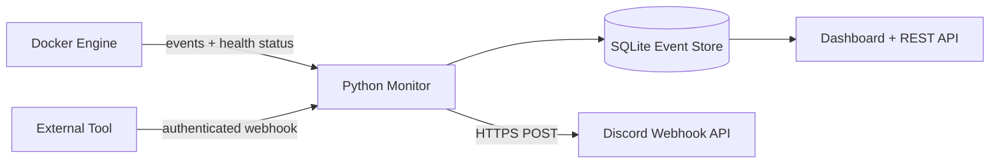

# Automated Container Health Monitoring and Real-Time Event Notifications

A DevOps mini project that watches Docker container health and lifecycle events, stores an audit trail in SQLite, and sends real-time notifications to a Discord channel through a webhook. It also accepts authenticated events from external monitoring tools.

## Project documentation

- [Mini project report](docs/Container_Health_Monitoring_Report.docx)
- [Classroom presentation](docs/Container_Health_Monitoring_Presentation.pptx)

## What the project demonstrates

- Docker image creation and multi-container orchestration with Docker Compose
- Native Docker `HEALTHCHECK` status monitoring
- Real-time Docker event-stream processing
- Discord Webhook API integration using rich embeds
- Secure inbound webhook integration using a shared-secret header
- Persistent event history with SQLite
- A live web dashboard and REST API
- Automated API tests with `pytest`

## Architecture



The monitor only watches containers with the label `health-monitor.enabled=true`. This avoids noisy alerts from unrelated containers.

## Prerequisites

- Docker Desktop or Docker Engine with the Compose plugin
- A Discord server where you can create a channel webhook
- `curl` for the optional API demonstration

## Configure Discord

1. In Discord, open **Server Settings → Integrations → Webhooks**.
2. Select **New Webhook**, choose the alert channel, and copy its URL.
3. Prepare the local configuration:

   ```bash
   cp .env.example .env
   ```

4. Open `.env`, replace the example `DISCORD_WEBHOOK_URL`, and choose a strong `WEBHOOK_SECRET`.

The `.env` file is ignored by Git. Never commit a real webhook URL because it acts like a password.

## Run the project

```bash
docker compose up --build -d
docker compose ps
```

Open [http://localhost:5001](http://localhost:5001) to view the dashboard. The Compose stack starts:

- `devops-health-monitor`: monitoring API, dashboard, and notification service
- `healthy-demo`: Nginx with a passing health check
- `unhealthy-demo`: a lab-only container with a deliberately failing health check

Within about 30 seconds, the unhealthy transition appears on the dashboard and in Discord. Follow the monitor output with:

```bash
docker compose logs -f monitor
```

Stop and remove the containers with:

```bash
docker compose down
```

Add `-v` only if you also want to erase the saved SQLite event history.

## Demonstrations for the lab

### 1. Health failure alert

The included `unhealthy-demo` automatically changes from `starting` to `unhealthy`. Show the corresponding event on the dashboard and in Discord.

### 2. Lifecycle event alert

```bash
docker stop healthy-demo
docker start healthy-demo
```

The monitor captures both lifecycle events and the later health transition.

### 3. External webhook alert

Use the same secret set in `.env`:

```bash
curl -X POST http://localhost:5001/webhook/events \
  -H "Content-Type: application/json" \
  -H "X-Webhook-Secret: change-this-lab-secret" \
  -d '{
    "container": "payment-api",
    "status": "critical",
    "details": {"message": "HTTP 503 threshold exceeded"}
  }'
```

Expected response:

```json
{"accepted":true}
```

### 4. Inspect the REST API

```bash
curl http://localhost:5001/health
curl "http://localhost:5001/api/events?limit=10"
```

## API reference

| Method | Endpoint | Purpose | Authentication |
|---|---|---|---|
| `GET` | `/` | Live event dashboard | None (lab use) |
| `GET` | `/health` | Service, Docker, and Discord readiness | None |
| `GET` | `/api/events?limit=50` | Recent event history | None (lab use) |
| `POST` | `/webhook/events` | Accept an external event | `X-Webhook-Secret` |
| `POST` | `/api/test-alert` | Send a Discord test event | `X-Webhook-Secret` |

## Run automated tests

For development outside Docker:

```bash
python3 -m venv .venv
source .venv/bin/activate
pip install -r requirements-dev.txt
pytest -q
```

The tests verify service health, event storage, input validation, and webhook authentication without sending a real Discord message.

## Key implementation decisions

- **Event stream plus polling:** Docker events provide low-latency notifications, while periodic polling catches state changes after temporary disconnections.
- **Labels:** Explicit opt-in keeps monitoring scope controlled.
- **Alert cooldown:** Repeated identical alerts are suppressed for 60 seconds by default.
- **Persistent volume:** Events survive monitor container restarts.
- **Bounded network operations:** Discord calls use an eight-second timeout so a slow API does not block monitoring indefinitely.
- **Escaped dashboard values:** Event text is escaped before insertion into the page.

## Security and production notes

This is intentionally a local lab project. Mounting `/var/run/docker.sock` gives the monitor powerful access to Docker even when the mount is marked read-only. In production, place a restricted Docker socket proxy between the monitor and the Docker daemon, run the application as a non-root user, terminate TLS at a reverse proxy, protect read endpoints, rotate webhook credentials, and use a production database or log platform.

## Troubleshooting

| Symptom | Check |
|---|---|
| Dashboard says Docker unavailable | Confirm Docker is running and the socket volume is mounted |
| Discord says not configured | Check `.env`, then recreate the monitor with `docker compose up -d --force-recreate monitor` |
| No monitored containers | Confirm the container label is exactly `health-monitor.enabled=true` |
| Duplicate messages | Increase `ALERT_COOLDOWN_SECONDS` |
| Port 5001 is occupied | Change `HOST_PORT` in `.env` and open that port |

## Future enhancements

- Prometheus metrics and Grafana dashboards
- Email, Slack, or Microsoft Teams notification adapters
- Alert acknowledgement and escalation policies
- Kubernetes liveness/readiness probe integration
- Signed webhooks using HMAC payload signatures
- Role-based access for the dashboard
